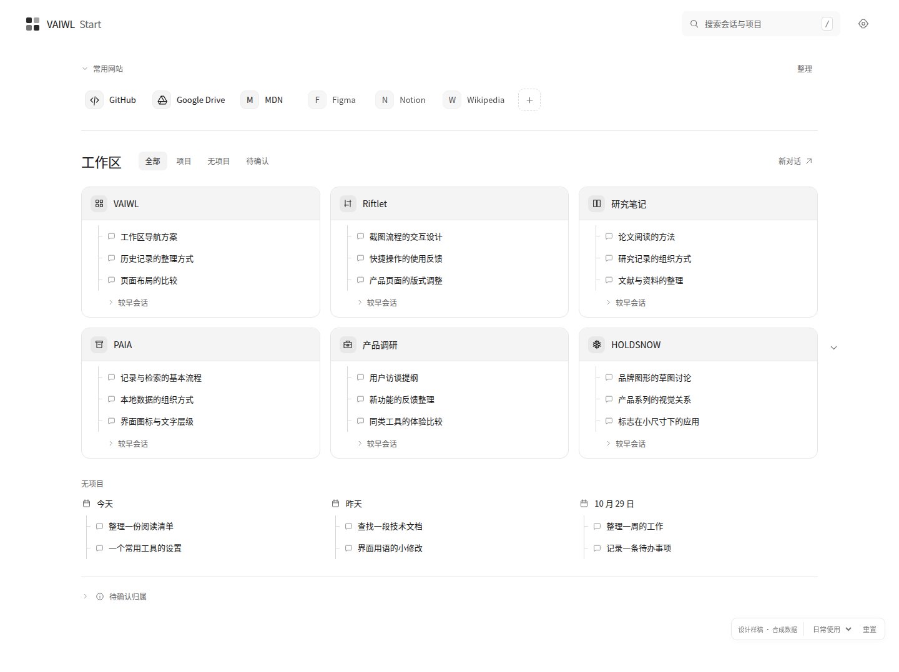

# vaiwl-start

A new tab workspace for ChatGPT conversations and projects.

## Free V1 development candidate

Implemented on the sole `codex/free-v1-implementation` branch, in [Draft PR #1](https://github.com/haohongfei2001-png/vaiwl-start/pull/1). The candidate has a persistent local directory, bounded browser-history import, scoped data/transaction core, the frozen new-tab UI, website management, and loadable MV3 packaging.

**LOCAL_WORKSPACE_READY:** imported UNKNOWN history is organized into explicitly labelled 30-day browsing windows. Trusted Start gestures plus exact browser navigation completion create local opening days, independently of ChatGPT body rendering. Bounded native Project panels can populate labelled local candidates. Account ownership, authenticated native Project/NONE and real Mac/Edge acceptance remain separately unverified; this is not FREE_V1_ACCEPTED. See the [user-approved local-first amendment](docs/free-v1/10-LOCAL-FIRST-AMENDMENT.md).

- [安装与实际使用](docs/INSTALL.zh-CN.md)
- [唯一实施状态](docs/IMPLEMENTATION_STATUS.md)
- [测试范围与限制](docs/TEST_RECORDS.md)
- [M0 来源门](docs/M0_SOURCE_GATE.md)

Build: `npm ci && npm run verify`. Load `dist` as an unpacked extension. `npm run package` creates a development ZIP from a committed, clean tree. Main remains unchanged; no store release.

## Free V1 design handoff

**VAIWL-START-FREE/1.0 — design specification, not a released extension.**

- [Start here · 冻结设计入口](docs/free-v1/00-READ-ME-FIRST.md)
- [Codex development instructions · 正式开发指令](docs/free-v1/07-CODEX-START.md)
- [Product spec](docs/free-v1/01-PRODUCT-SPEC.md) · [Interaction design](docs/free-v1/02-INTERACTION-DESIGN.md)
- [Data contract](docs/free-v1/03-DATA-CONTRACT.md) · [Source reliability](docs/free-v1/04-SOURCE-RELIABILITY.md)
- [Architecture and reuse](docs/free-v1/05-ARCHITECTURE-AND-REUSE.md) · [Acceptance criteria](docs/free-v1/06-ACCEPTANCE.md)
- [Offline interactive design prototype](design/free-v1/prototype.html) — download and open locally; all content is synthetic.

The extension will keep a local, persistent directory of visited ChatGPT conversations, native projects, and user-managed website shortcuts. Free V1 does not read message bodies or depend on an AI API.

The standalone homepage avoids the original VAIWL host-mount dependency. Reliable live account/context and explicit NONE membership sources remain required engineering gates, not capabilities proven by this design prototype. See the source matrix and acceptance criteria before making product readiness claims.
