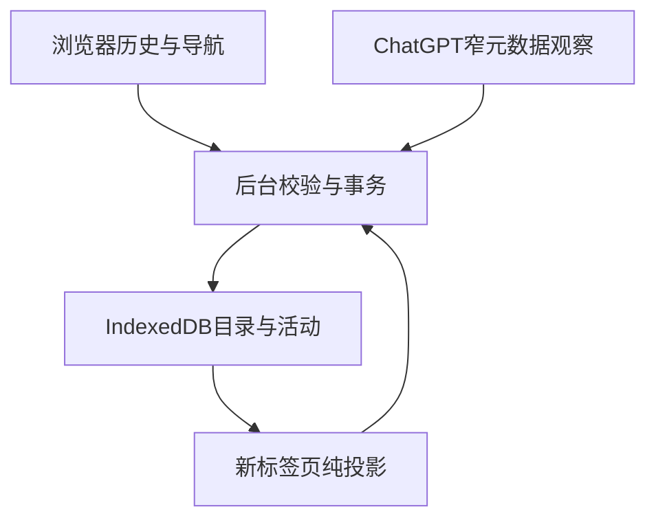

# 工程架构、复用与实施顺序

## 1. 独立新标签页架构

生产采用 TypeScript、原生MV3、IndexedDB和轻量DOM渲染；构建工具可用Vite，只承担打包、类型检查与本地开发。无需React、后端、登录服务、模型SDK、Supabase或iframe。具体依赖锁定后提交lockfile，禁止运行时远程脚本。设计HTML只作视觉参考，不能原样装入MV3（其中inline脚本与合成数据不符合生产入口）。

首页拥有自己的extension-origin文档，ChatGPT仍在普通浏览器tab中。Start不接管正文/输入、native sidebar、paint wrapper或原四格返回。因此原Free挂载不成功不会成为Start绘制首页的前置。

## 2. 精确模块划分

| 模块 | 输入→输出 | 责任与禁止项 |
|---|---|---|
| domain/ids.ts | URL/身份元组→稳定ID与canonical key | 精确host/path；title不能作key |
| domain/time.ts | instant+IANA+ViewSession→civil day/30日段 | 摘取旧纯函数；不联网 |
| domain/open-activity.ts | 已确认intent→OpenDay+活动摘要 | 同日去重；不产生UserSendEvent |
| domain/membership.ts | scope-bound witness→三态归约 | 强证据/冲突/旧epoch；不以null推NONE |
| domain/projection.ts | 目录/活动/ViewSession→项目卡/日期组/待确认 | P单段，旧成员留父卡，稳定平局排序 |
| storage/db.ts | 严格类型→IDB事务 | 原子迁移、唯一键、CAS、quota错误 |
| storage/repository.ts | commands/queries→有限记录集合 | 唯一业务写入口；无原始payload库 |
| background/permissions.ts | 用户授权/撤权→能力状态 | 动态注册/停止collector；非后台弹权限 |
| background/import-history.ts | history API→staging/checkpoint | 有界分段/饱和、严格过滤、无活动回填 |
| background/open-broker.ts | UI intent→tabs/windows导航→确认 | 先存意图；不批量/搬移/复用其他tab |
| background/navigation.ts | 浏览器事件→绑定/关联候选 | documentId、sessionId、routeEpoch；过滤非目标域 |
| background/owner.ts | 受控消息→验证/归约/事务→revision | 权威scope来自自身验证，不采信页面自报 |
| collectors/chatgpt/navigation.ts | 允许链接受信事件→意图提案 | 不读键入字符、不抓正文 |
| collectors/chatgpt/metadata.ts | 标题叶/成员关系→字段提案 | 只读特定区域；不全DOM扫描或网络拦截 |
| collectors/chatgpt/identity.ts | 固定session-only读取→身份候选 | 禁止完整conversation链；token不外传/落库 |
| collectors/chatgpt/profile.ts | 版本化选择器/语义白名单 | 未现场验证能力默认关闭；失败有明确码 |
| ui/newtab.ts | 纯投影→首页 | 只使用严格查询结果，不访问网页DOM |
| ui/search.ts | 用户查询→本地索引结果 | 标题/路径搜索；不全文、不跨scope混排 |
| ui/shortcuts.ts | 用户操作→快捷入口commands | 固定/排序/折叠，非浏览器bookmarks |
| ui/view-state.ts | k/焦点/滚动锚→恢复 | 多tab视图独立，安全时点重排 |

UI、业务纯函数和browser adapter通过明确接口分离。测试browser adapter用假的窄接口注入，禁止用生产profile中的测试后门或任意URL参数开启synthetic信任。

## 3. 可复用清单（固定SHA）

上游根链接：[1903b00f…](https://github.com/haohongfei2001-png/Virtual-AI-Workspace-Layer/tree/1903b00f774b4fd7f3d15b3669878c32e2c7a9c8)。每个摘取函数保留来源说明和原hash，写入实现仓库的`UPSTREAM.md`；不复制原整套仓库或百万行证据。

| 等级 | 真实文件/函数 | Start处理 |
|---|---|---|
| 直接摘取 | src/navigation/projection.mjs::instant/localDay | 只摘这两个纯时间函数；不导入synthetic的project/latestSend |
| 直接摘取 | src/data/free-time-policy.mjs::createFreeViewSession/freeSegmentFor/freeWindowFor/relocateFreeSegment | H固定30；保参数/边界语义，不启用autoH |
| 适配复用 | src/data/free-activity.mjs::aggregateFreeActivity | 新OpenActivity输入；保P成员max、同值稳定、单段与旧子项；不可连带发送proof |
| 适配复用 | src/host/url-policy.mjs::createURLPolicy | 保编码/query/route拒绝；明确旧域别名，不靠删所有query猜身份 |
| 适配复用 | src/host/native-surface-boundary.mjs::observedProjectAssociation/observedProjectListTitle | 拆出限定DOM关系与标题叶，去掉挂载mask依赖；重新验反例 |
| 候选先验 | src/runtime/session-provider.mjs::createSessionProvider(...).read() + src/host/session-identity.mjs | 新文件仅保session-only依赖，切断message/conversation imports；真实context仍需证明 |
| 规则复用 | src/data/native-facts.mjs、free-projection.mjs、docs/DATA_MODEL.md | 三态/见证/last-known/冲突语义，新Start数据表；不伪造旧admission |
| 视觉复用 | design/approved/v2.7/VAIWL_v2.7/prototype-v2.7.html | 色板/密度/层级/左侧旧项/5+12；重新做新标签页布局 |
| 不移植 | host content-session/mount/controller/popover/frame/mask | 没有宿主挂载需求 |
| 不移植 | readCurrentConversation、消息/ACK/selection/body、片段、Pro | 违反本轮范围或无正文合同 |
| 不移植 | 原Free完整IDB/schema、权限lease、百万行测试/实机诊断 | 独立小数据合同；仅挑适用不变量测试 |

## 4. IPC与隐私边界

所有runtime消息都有固定protocol、operation ID、revision和精确payload白名单。内容脚本只能提交字段提案与受信意图，不能GET其他账号目录、列出本地历史、选择scope、改权限、发任意fetch请求。extension sender/topframe/document、scopeEpoch与routeEpoch都要校验。无externally_connectable或window.postMessage任意入口。

只有settings/debug页面可显示有限状态码与适配器版本；日志不含标题、URL明文、原始body、凭证。采集范围由生产代码白名单与测试证明，不把“未保存正文”当“未读取正文”。选择器变体失败应停止该字段读取，不能回退document.body.innerText、全行textContent或全文响应。

## 5. 开发顺序与退出条件

### M0：实际来源最小竖切（最先）

先建立新仓分支与最小MV3壳，落地session-only身份、当前context、限定P、明确NONE、一次主动打开。测试数据为用户选定的合成ChatGPT会话，只保存脱敏结构/字段/断言和精简回执。按04来源门的具体顺序执行；原仓只读。

输出：metadata-profile及其支持字段/失败码、正反例、真实浏览器与build SHA。通过标SOURCE_GATE_PASS；否则SOURCE_GATE_BLOCKED并按字段关闭，留下能重现的最短缺口。不会因为M0缺证据而重写旧Free挂载或改旧仓。

### M1：纯模型、IDB与持久目录

实现类型验证、URL policy、schema/事务、staging、逐条scope绑定、三态归约、OpenDay、30天/稳定排序、墓碑。导入按批次恢复，history事件只发现。用非同构输入反例验证边界，不写镜像实现的空测试。

### M2：首页完整竖切

实现已冻结视觉与交互：项目卡、NONE日期组、UNKNOWN、历史切换、搜索、旧项/5+12、网站操作、首次安装、权限状态、在真实浏览器中打开/返回。早期可在开发专用fixture页使用合成样本，生产入口禁止默认注入演示数据。

### M3：真实采集与活动闭环

连接已过M0的适配器；Start和原生链接意图→抵达→原子活动；双tab、worker退出、权限撤销、账号切换、路由竞态、午夜/DST/空段。地址栏规则单独门控，失败只降级该入口，不猜测。

### M4：Chrome与Edge日用验收及交付

实际侧载、安装首屏/导入/Project/NONE/UNKNOWN/打开关闭再进/重启/垂直标签/键盘/缩放；按06逐项附证据与构建SHA。生成可加载开发包、安装说明与剩余限制。保持Draft，不合main、不发布。

## 6. 工程指标（目标，不是本次成绩）

普通2000条本地目录、20项目样本：首页可交互p95≤500ms（扩展页面navigationStart→核心控件可用，不算浏览器启动）；已加载目录的搜索反馈p95≤100ms；活动入库后首页安全更新≤1秒。首次导入和慢身份读取不阻塞已有缓存首屏。

每批最多500历史返回/200条写入；纯查询不扫描消息或全站数据；DOM观察去抖150ms、只观察限定导航容器，不对document.body安装无限递归文本处理。测试worker可被正常终止，不以定时器保活。性能结果报告机器、浏览器、样本与冷热条件，不拿样稿渲染速度充生产成绩。

## 7. 未来接口留位

`PortableCatalogV1`只冻结数据交换方向，V1不实现跨扩展同步、自动导出/恢复或外部消息。未来共享须额外版本化导入验证；备份中的旧来源不能自证活体身份。Pro将使用独立overlay表，引用recordKey，不写原生事实。现在不创建Pro UI、收费、模型schema或API调用。
